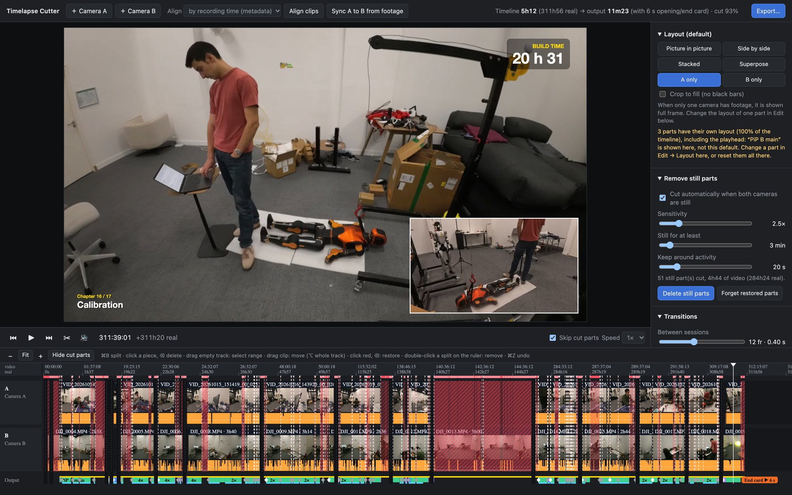

# Timelapse Cutter

A small iMovie-style editor for a timelapse filmed with **two cameras**. Put both on one timeline,
choose how to combine them, cut the parts where nothing happens, and export one video.



## Run

Needs Python 3 with `numpy`, and `ffmpeg` on the PATH (`brew install ffmpeg`).

```bash
python3 cutter.py --project ~/Movies/my-build --a ~/Movies/camA --b ~/Movies/camB
```

It opens in the browser at `http://localhost:8765`. `--a` / `--b` are optional, since videos can also be added
from the UI. The project, its analysis cache and the exports live in the `--project` folder. Run the same
command again to pick up where you left off.

## What it does

- **Two cameras, one timeline.** Clips line up by recording time. **Sync A to B from footage** fixes camera
  clocks that drift, by matching both cameras' activity. Nights and breaks shrink to thin spacers.
- **Layouts.** Picture in picture, side by side, stacked, superposed or one camera, set for the whole video
  or for any part.
- **Auto-cut still parts.** Each clip's activity is analysed in the background. Stretches where neither
  camera changes are cut, and anything you restore stays restored.
- **iMovie-style editing.** Split, select, delete, undo, with cross-dissolves at session changes and cuts.
- **Speed.** Speed up any part, or let **Auto speed** fit a target length by speeding up the quiet parts.
  Changes ramp smoothly.
- **Privacy.** Draw blur areas, auto-blur screens (OWLv2 + SAM) and scan the kept footage for readable
  private text (Apple Vision).
- **Titles.** Chapter titles, a build-time counter, an opening sequence and an end card (`intro.py`).
- **Music.** Add songs or generate them with [ACE-Step 1.5](https://github.com/ace-step/ACE-Step-1.5), with
  crossfades and fades.
- **Export.** Up to 4K, wide or vertical, at 30 or 60 fps, with x264 or Apple hardware encoding. Photos
  skipped by a speed-up can be blended into motion blur.

Optional extras: `pip install torch transformers` for screen auto-blur, Xcode command-line tools for the text
check, and a local ACE-Step server for music generation.

## Keys

| Key | Action | Key | Action |
| --- | --- | --- | --- |
| Space | play / pause | ⌘B or S | split at playhead |
| ← / → (⇧ = 1 s) | step a frame | ⌫ | delete selection / restore a cut |
| ↑ / ↓ | previous / next kept part | W | swap picture-in-picture here |
| I / O | selection in / out | H | hide / show cut parts |
| + / − / 0 | zoom in / out / fit | ⌘Z / ⇧⌘Z | undo / redo |
